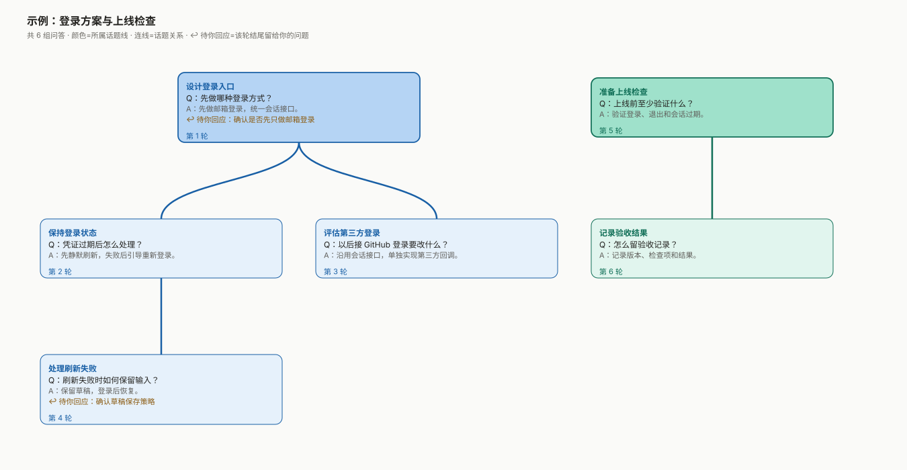

# Untangle My Mind

**一句 `/untangle-me`，把当前 Session 画成脑图。**

一次调试聊了二十轮：试过哪些方案？为什么放弃第一条路？还有哪个决定等你拍板？**Untangle My Mind** 把当前会话的提问和主要回答整理成脑图，不用复制聊天记录，也不用再往上翻。

| 在 OpenCode 输入指令 | 你会得到 |
| --- | --- |
| `/untangle-me` | 用模型梳理话题、追问和方案分支，生成思路脑图 |
| `/untangle-me --just-list` | 不调用模型，按轮次排列问答并生成脑图 |

- **回看全程**：读取完整会话历史，包括上下文 compact 之前的消息。
- **看清思路**：默认用模型按追问、分支和话题关系重组脑图。
- **保留原文**：HTML 明细和 JSONL 保存提取的问答；思路脑图的图上节点则保持简洁。
- **方便浏览与分享**：HTML 支持按住鼠标拖动画布、复位位置，还可导出 SVG 和 Mermaid。



[HTML 交互示例](examples/sample.html) · [SVG 原图](examples/sample.svg) · [问答 JSONL](examples/sample.jsonl) · [Mermaid 源码](examples/sample.md) · [节点树 JSON](examples/sample.json)

这是 `/untangle-me --all` 的输出示例，使用虚构对话。连线表示话题关系，同级分支一视同仁，`↩` 标出待确认事项。下载 HTML 后用浏览器打开，可拖动、复位，并展开节点查看问答原文。

## 两种看法，同一场对话

| 模式 | 适合回答 | 怎么整理 |
| --- | --- | --- |
| **思路脑图** `/untangle-me` | 哪些是追问，哪些是备选方案，哪里还等我确认？ | 让模型按话题重组：连续追问向下延伸，并行方案从共同问题分支，新话题另起一条线。 |
| **问答脑图** `/untangle-me --just-list` | 这一轮我问了什么，OpenCode 怎么答的？ | 不调用模型，按对话顺序保留问题与主要回答，不把工具调用或推理片段当作问答导出。 |

思路脑图中，同一话题由上向下展开，不同话题从左向右并列。图上使用模型摘要；HTML 的节点明细通过消息 ID 对应原始问答，缺少 ID 时尝试按轮次匹配。引用无法匹配或相互冲突时会明确标注，不把摘要当作原文。

比如，一场对话先讨论「怎么做登录」，再追问「怎么刷新 token」，之后回头比较「要不要改用 OAuth」。普通模式保留这三轮的顺序；思路模式则尝试把「刷新 token」和「改用 OAuth」接回各自相关的问题，让你看出讨论是怎么分岔的。

适合用在 **调试复盘**（回看每一步为什么试）、**方案评审**（对比走过的路线）和 **任务交接**（分享结论和待确认事项）。

## 安装

需要 [OpenCode 2](https://opencode.ai/docs/) 和 Git。仓库名为 [`wyn-ying/untangle-my-mind`](https://github.com/wyn-ying/untangle-my-mind)，安装目录名为 `untangle-my-mind`。

**全局安装** · 所有项目都能用：

```sh
mkdir -p "${XDG_CONFIG_HOME:-$HOME/.config}/opencode/plugins"
git clone https://github.com/wyn-ying/untangle-my-mind.git \
  "${XDG_CONFIG_HOME:-$HOME/.config}/opencode/plugins/untangle-my-mind"
```

**仅为当前项目安装** · 在项目根目录运行：

```sh
mkdir -p .opencode/plugins
git clone https://github.com/wyn-ying/untangle-my-mind.git \
  .opencode/plugins/untangle-my-mind
```

任选一种安装方式即可。OpenCode 会[自动发现](https://opencode.ai/docs/plugins#discover)这些目录下的插件，无需修改 `opencode.json`，也不用手动运行 `npm install`。如果已打开的会话里没有出现命令，可用 `/reload` 重新加载配置。

插件需要读取完整会话历史，包括 compact 之前的消息。若插件 API 不直接提供历史接口，会通过 `opencode api` 读取；这要求命令行能连接到承载该会话的服务。独立服务或远程服务环境下若无法连接，插件会报错，而不会静默导出不完整的上下文。

## 30 秒上手

1. 打开一个已有问答的 OpenCode 会话。
2. 在会话输入框输入 `/untangle-me`，不是在 shell 里运行。如果不想调用模型，输入 `/untangle-me --just-list`。
3. 在生成结果里找到 HTML 文件，用浏览器打开：上半部分是脑图，下半部分可以逐条展开。按住鼠标左键可拖动画布，点击脑图右上角的 **复位** 可回到初始位置。

| 会话命令 | 用途与导出结果 |
| --- | --- |
| `/untangle-me` | 问答 JSONL + 按话题重组的 HTML、SVG |
| `/untangle-me --all` | 默认文件 + 节点树 JSON、Mermaid Markdown |
| `/untangle-me --just-list` | 不调用模型，按轮次导出问答 JSONL、HTML、SVG |
| `/untangle-me --just-list --all` | 按轮次导出问答，并追加 Mermaid Markdown |
| `/untangle-me --model provider/model-id` | 指定重组用的模型，把示例 ID 换成 OpenCode 中已配置的模型 |
| `/untangle-me --clear` | 清理当前会话目录中插件生成的 JSONL、HTML、SVG 和 Mermaid Markdown 文件；空目录也会删除 |

思路模式默认使用当前会话的模型；如果无法识别，或你想换一个模型，用 `--model` 指定。`--just-list` 不调用模型，因此 `--model` 在该模式下不生效。生成开始时会提示；等待超过 10 秒时会再次提示，结束后发送结果和文件链接。部分终端界面可能在输入框下方显示动态状态，具体取决于 TUI 插件是否正常加载。模型生成通常需要几十秒到一两分钟。

## 文件去哪了？

默认写到项目根目录下的 `.opencode/mindmaps/<会话标题>-<会话ID>/`，同名会话各用独立目录。文件名以 `r<问答轮数>_<本地时间>` 开头，时间精确到分钟：

- 默认思路脑图：例如 `r12_2026-11-19T23-54.html`。
- `--just-list` 问答脑图：例如 `r12_2026-11-19T23-54-just-list.html`。该后缀也用于同次导出的 JSONL、SVG 和 Mermaid 文件。

同一种模式在同一分钟内重复运行会覆盖同名文件，两种模式的文件互不覆盖。结果消息会列出文件链接和路径；如果链接不能打开，复制路径到浏览器即可。远程使用时，路径位于运行 OpenCode 服务的机器上。

`/untangle-me --clear` 也会查找会话改名之前、带同一会话 ID 的目录；只删除符合插件命名规则的上述格式文件。其他文件（包括思路模式下 `--all` 生成的节点树 JSON）会保留，目录非空时不会删除。旧版不带会话 ID 的目录无法可靠区分同名会话，不会自动清理。

- **HTML**：离线浏览脑图和折叠明细，支持拖动和复位，不需要额外服务。
- **SVG**：打开即看，也可以嵌入项目文档或用在汇报里。
- **JSONL**：一行一组问答，方便搜索或交给脚本处理。
- **Mermaid / 节点树 JSON**：适合在支持 Mermaid 的文档里继续编辑，或把重组后的节点交给其他工具使用。

> 输出文件可能包含源码、路径或其他会话敏感信息。分享前请先检查；不想把导出提交进仓库，可将 `.opencode/mindmaps/` 加到 `.gitignore`。默认模式会把提取出的问答提交给所选模型重组，其中每条回答只发送前 1500 个字符；HTML 明细和 JSONL 不受这一截断影响。不想把问答发送给模型时，请用 `--just-list`。模型可能误判话题关系或遗漏节点，重要结论请对照原始问答核实。

## 许可证

本项目采用 [MIT License](LICENSE)，版权归 wyn-ying 所有。欢迎使用、修改和分享；分发时请保留版权声明和许可证文本。
